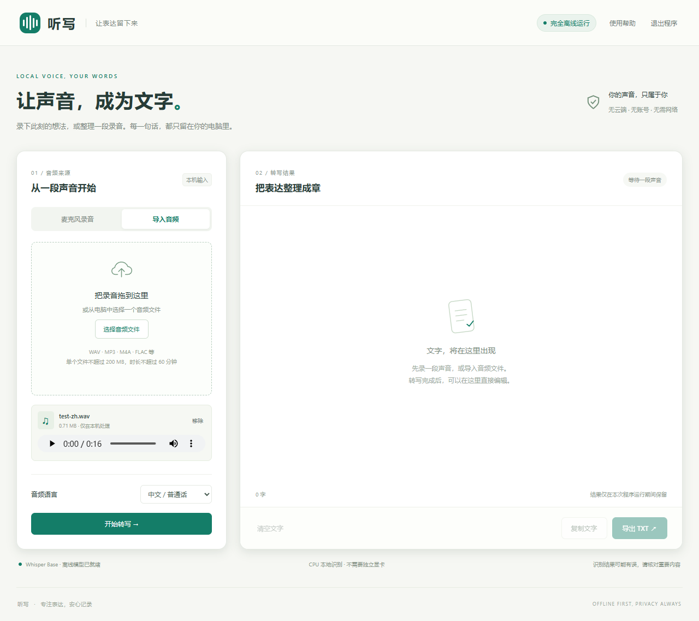
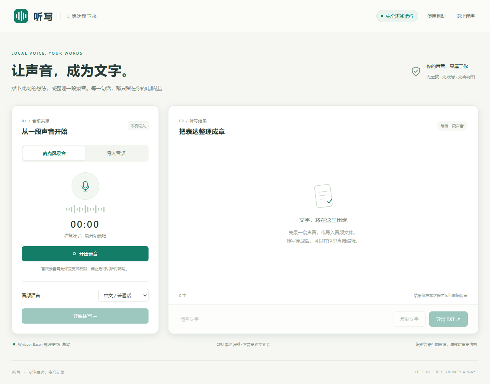

# 听写 · Tingxie

> 让声音，成为文字。一款**完全离线**的 Windows 本地语音转文字工具 —— 模型与运行环境全部内置，首次使用也不需要联网。

<p align="left">
  
  
  
  
</p>


<p align="center">
  
  
</p>

---

## 这是什么

**听写**是一款「双击就能用」的离线语音转文字小工具：录一段话，或者拖进一个音频文件，几秒到几分钟后拿到可编辑的文字。

- 音频**不上传**任何云端，识别在本机 CPU 上完成；
- 不需要账号、不需要 API Key、不需要显卡；
- 解压后双击 `Tingxie.exe`，浏览器里操作，界面像本地应用。

适合课堂录音整理、会议记录、口述笔记、采访素材转写等场景。

## 功能

| 能力 | 说明 |
| --- | --- |
| 🎙 麦克风录音 | 浏览器内录音，停止后可先试听，再决定是否转写 |
| 📂 导入音频 | 支持 WAV / MP3 / M4A / MP4 / FLAC / OGG / WEBM / AAC / WMA / OPUS |
| 🌐 语言识别 | 中文（普通话）、英语，或交给模型自动检测 |
| ✍️ 结果处理 | 文字可编辑、复制、导出 UTF-8 TXT（带 BOM，Excel/记事本不乱码） |
| 📊 进度可见 | 解码 → 语音检测 → 加载模型 → 逐段识别，实时百分比与阶段提示 |
| 🧹 不留痕迹 | 临时音频在任务结束即删除；结果只存在内存中，退出即清空 |
| 🔒 本机防护 | 仅监听 `127.0.0.1`，校验 Host / Origin / 一次性访问令牌，防止局域网访问与跨站调用 |
| ⌨️ 全局听写 | 鼠标侧键一按开始、再按结束，识别结果直接粘贴到任意前台窗口（无需切窗口） |

## 快速开始（普通用户）

1. 在 [Releases](../../releases) 下载 `Tingxie-Windows-x64-offline.zip`（约 250 MB）；
2. **完整解压**到任意目录（不要只把 EXE 拖出来，`_internal` 里是模型和运行环境）；
3. 双击 `Tingxie.exe`，程序会自动打开浏览器页面；
4. 录音或导入音频 → 选语言 → 开始转写 → 编辑/复制/导出。

> 首次识别会加载模型，CPU 上需要几秒预热；之后的转换更快。

## ⌨️ 全局听写：按一下侧键说话，文字直接上屏

不想切窗口、不想打字的时候用它：**按一下鼠标侧键开始录音，再说一遍，再按一下结束，1–2 秒后文字出现在你当前光标处**（微信、Word、IDE、浏览器输入框都行）。

```
按侧键 ↓                 说话               按侧键 ↓            1–2 秒后
叮咚（升调）  →  麦克风录音（升调提示）  →  叮咚（降调）  →  文字自动粘贴进当前窗口
```

### 怎么用

1. 双击解压目录里的 **`听写-全局输入.cmd`**（等价于 `Tingxie.exe --dictate`）；
2. 先按一次侧键试试：有升调提示音就是开始录音，再按一次即有降调音并开始识别；
3. 文字会以「粘贴」的方式进到前台窗口，原剪贴板内容会自动还原。

### 侧键没反应？

不同鼠标的侧键可能发的是鼠标事件（XBUTTON1/XBUTTON2），也可能被厂商驱动改成了键盘键。先诊断 30 秒：

```powershell
Tingxie.exe --dictate --probe
```

30 秒内按一下你的侧键，看输出的那一行：

| 看到 | 就用 |
| --- | --- |
| `mouse: 侧键按下 XBUTTON1` | `--button x1`（默认） |
| `mouse: 侧键按下 XBUTTON2` | `--button x2` |
| `key: vk=0x78`（例：F9） | `--button f9` |
| 什么都没打印 | 侧键被厂商驱动拦走了，改用键盘键，或先在鼠标驱动里把侧键映射成某个键 |

再不确定就跑一次**自检**（它自己合成事件，不动你的鼠标、不会点到别的窗口）：

```powershell
Tingxie.exe --dictate --selftest
```

- 输出「自检通过」→ 钩子在这台机器上可用，侧键方案没问题；
- 输出「自检失败」→ 改用备用快捷键：`Tingxie.exe --dictate --hotkey ctrl+alt+d`。

程序每次启动也会做同样的自检，若发现钩子收不到事件，会**自动切到 `ctrl+alt+d`** 并在窗口里提示。

### 常用参数

| 参数 | 作用 |
| --- | --- |
| `--button x1\|x2\|f9\|capslock…` | 触发键，默认 `x1`（鼠标后退侧键） |
| `--hotkey ctrl+alt+d` | 备用快捷键：不依赖鼠标钩子，钩子失效时用它 |
| `--selftest` | 自检钩子是否可用（自己合成事件，2 秒出结果） |
| `--probe` | 诊断：打印你按下的侧键/键盘键 |
| `--debug-events` | 打印钩子收到的每个侧键事件（含 injected 标记） |
| `--language zh\|en\|auto` | 识别语言，默认 `zh` |
| `--type` | 逐字输入而不是粘贴（少数屏蔽 Ctrl+V 的终端用它） |
| `--keep-clipboard` | 识别后把文字留在剪贴板，方便再贴一次 |
| `--no-paste` | 只打印识别结果，不往窗口里注入任何东西 |
| `--device N` | 指定麦克风，`--devices` 列出所有输入设备 |
| `--max-seconds 120` | 单次录音上限，默认 120 秒 |
| `--silent` | 关闭提示音 |

录音中按 **Esc** 取消本次录音；关闭控制台窗口即退出听写模式。

### 为什么这样设计

- **不落盘**：Audio 从麦克风直接进内存（16 kHz 单声道），识别完即丢弃，比网页版还少一次临时文件；
- **吃掉侧键事件**：钩子返回 1，浏览器不会因为「后退键」而翻页；
- **粘贴而不是模拟打字**：中文长句用剪贴板最快、最稳，且支持撤销（Ctrl+Z）；
- **只在本机**：和网页版共用同一个 `transcriber.py`，没有任何网络请求。

> 局限：粘贴目标是**当前前台窗口**，如果前台是管理员权限的程序（任务管理器、以管理员身份运行的终端），Windows 的 UIPI 会拒绝普通进程注入，此时文字会留在剪贴板里，手动 Ctrl+V 即可。

## 从源码运行

```powershell
git clone https://github.com/jyuaner/Tingxie.git
cd Tingxie

python -m venv .venv
.\.venv\Scripts\Activate.ps1
python -m pip install -r requirements.txt

# 把 Whisper Base（faster-whisper / CTranslate2 格式）放进 models/whisper-base/
python scripts/fetch_model.py

python app.py            # 网页版：默认自动选空闲端口并打开浏览器
python app.py --port 8722 --no-browser --debug
python dictation.py     # 全局听写：侧键触发，结果自动上屏
python dictation.py --probe   # 不确定侧键发什么时先用诊断模式
```

`models/whisper-base/` 需要四个文件：

```
models/whisper-base/
├── model.bin          # CTranslate2 权重（int8 也可）
├── config.json
├── tokenizer.json
└── vocabulary.txt
```

`scripts/fetch_model.py` 从 `Systran/faster-whisper-base` 下载并放到该目录（仅首次运行需要联网，之后程序本身完全离线）。

## 打包为离线单目录 EXE

```powershell
python -m pip install pyinstaller
python -m PyInstaller tingxie.spec --noconfirm
```

产物在 `dist/Tingxie-windows-x64/`：`Tingxie.exe` + `_internal/`（含 `models/whisper-base`、`static/`、`templates/`、`sounddevice` 的 PortAudio DLL）以及 `听写-全局输入.cmd`。
把这个目录整体压缩即得到可分发离线包。`scripts/build.ps1` 封装了上面两步。

## 技术架构

```
【全局听写】  dictation.py
鼠标侧键(XBUTTON1/2) → WH_MOUSE_LL 钩子 → sounddevice 内存录音
       ↓ 再按一次
transcriber.py 的 transcribe_array()  →  剪贴板 + Ctrl+V 粘贴进前台窗口
（Esc 取消 · 提示音反馈 · 吃掉侧键事件避免浏览器后退）

【网页版】
┌───────────────────────── 浏览器（本机） ─────────────────────────┐
│  templates/index.html + static/app.js + core.mjs + style.css     │
│  录音(MediaRecorder) · 拖拽导入 · 编辑/复制/导出 · 轮询进度        │
└───────────────▲──────────────────────────────────────┬───────────┘
                │ fetch + X-App-Token                  │ multipart 音频
┌───────────────┴──────────────────────────────────────▼───────────┐
│  Waitress（127.0.0.1，随机端口）  ←  Flask  webapp.py            │
│  Host/Origin 校验 · CSP · 201 MiB 请求上限 · 单任务队列(JobManager)│
└───────────────▲──────────────────────────────────────┬───────────┘
                │ 进度回调 progress/stage/text          │ 后台线程
┌───────────────┴──────────────────────────────────────▼───────────┐
│  transcriber.py （文件与内存波形共用同一套识别流程）                 │
│  PyAV 解码 → 16 kHz 单声道 int16（硬上限 3600 s）                  │
│  Silero VAD 切片 → faster-whisper Whisper Base（CPU / int8）      │
└──────────────────────────────────────────────────────────────────┘
```

- **前端**：原生 HTML/CSS/ES Module，无构建步骤，无框架依赖。
- **后端**：Flask + Waitress（生产级 WSGI，多线程），单任务队列，结果驻留内存。
- **全局听写**：Win32 低级鼠标/键盘钩子（`ctypes`，无第三方钩子库）+ PortAudio 内存录音；上屏用剪贴板 + `SendInput` 注入，剪贴板内容会自动还原。
- **识别**：`faster-whisper` + CTranslate2，`device="cpu"`、`compute_type="int8"`、`cpu_threads=min(4, cpu_count)`；开启 VAD 过滤与 `beam_size=3`，中文额外注入简体标点提示词。
- **打包**：PyInstaller onedir，模型、静态资源与 PortAudio DLL 一并收集。

### HTTP 接口

| 方法 | 路径 | 说明 |
| --- | --- | --- |
| GET | `/` | 单页界面（注入一次性 `X-App-Token`） |
| GET | `/api/info` | 模型名、离线标记、上传上限、是否就绪、最近任务 |
| POST | `/api/transcriptions` | `multipart/form-data`：`audio` 文件 + `language`（`zh`/`en`/`auto`），返回 `202 {id}` |
| GET | `/api/transcriptions/<id>` | 任务快照：`state`、`stage`、`progress`、`text`、`segments`、`duration`、`language`、`error` |
| POST | `/api/shutdown` | 空闲时优雅退出本地服务 |

错误统一为 `{"error": "..."}`；状态码覆盖 `400 / 403 / 404 / 409 / 413 / 503`。

## 目录结构

```
Tingxie/
├── app.py               # 启动器：选端口、起 Waitress、开浏览器（--dictate 走全局听写）
├── dictation.py         # 全局听写：侧键钩子、内存录音、粘贴/键入上屏
├── webapp.py            # Flask 应用、安全校验、单任务队列
├── transcriber.py       # 音频解码 + Whisper 推理（文件与内存波形共用）
├── listen.cmd           # 双击即进全局听写模式的启动脚本
├── templates/index.html # 界面结构
├── static/
│   ├── app.js           # 交互逻辑（录音、上传、轮询、导出）
│   ├── core.mjs         # 纯函数：校验、时间格式化、字数统计
│   ├── style.css        # 设计系统与动效
│   └── favicon.svg
├── models/              # 放置 whisper-base（不随仓库分发权重）
├── scripts/
│   ├── fetch_model.py   # 下载并校验模型文件
│   └── build.ps1        # 一键打包离线包
├── tingxie.spec         # PyInstaller 配置
├── requirements.txt
└── docs/images/
```

## 性能参考（CPU，无独显）

| 机器 | 示例 | 10 分钟音频耗时 |
| --- | --- | --- |
| i5-1135G7 (4 线程) | whisper-base int8 | ≈ 1.5–2.5 分钟 |
| R5-5600U (4 线程) | whisper-base int8 | ≈ 1.5–2.5 分钟 |
| 老款 i5-8250U | whisper-base int8 | ≈ 3–5 分钟 |
| 低功耗赛扬/奔腾 | — | 明显更慢，长音频建议拆分 |

> 实测值随音频内容、语音密度与后台负载波动，仅供参考。VAD 会跳过静音段，静音越多越快。

## 已知限制

- 仅提供 **Windows 10/11 64 位** 构建，老旧 CPU 是否兼容取决于指令集（AVX2 通常更稳）；
- 单个文件上限 **200 MB / 60 分钟**，超出会被前端与后端同时拦截；
- **录完再转写**，不是实时流式识别（全局听写也是「说完再按一下」，停顿后才有字）；
- 没有说话人分离、没有自动摘要、没有标点/断句模型二次校正；
- 噪声、口音、专业术语仍会出错，重要内容请人工校对；
- 结果只保存在内存，关闭程序即清空 —— 记得先导出；
- 界面为单任务串行：一个任务跑完才能提交下一个；
- 全局听写的上屏目标是**当前前台窗口**，管理员权限的窗口会因 UIPI 拒绝接收（文字会留在剪贴板）。

## 隐私说明

- 推理全部在本机完成，程序没有任何外发网络的业务请求；
- `HF_HUB_OFFLINE=1`，即使模型目录缺失也不会触发在线下载；
- 上传的音频写入系统临时目录，任务结束（完成或失败）立即 `unlink`；
- 服务只绑定 `127.0.0.1`，并通过一次性 token 拒绝非本页面发起的请求。

## 常见问题

**双击后浏览器没打开？** 看控制台窗口打印的地址，手动访问 `http://127.0.0.1:<端口>/`。端口每次启动随机，避免冲突。

**提示「离线模型不完整」？** 解压不完整。请完整解压 zip，确认 `_internal/models/whisper-base/` 下四个文件齐全（`model.bin` 约 138 MB）。

**提示「已有任务正在处理」？** 单任务队列，等当前任务结束或重启程序。

**转写结果为空？** 程序会先做语音活动检测，音量过低/纯静音会被判定为无语音。检查系统输入设备、调高录音音量。

**全局听写：按侧键没反应？** 先跑 `Tingxie.exe --dictate --probe`，30 秒内按一下侧键看它发的是 `XBUTTON1/2` 还是某个键盘键，再对应 `--button x1/x2/f9`。完全没输出说明被鼠标厂商驱动拦走了，改映射或换键盘键。

**全局听写：识别了但没进窗口？** 目标窗口若以管理员权限运行，Windows 会阻止普通进程注入（UIPI）；文字会留在剪贴板，手动 Ctrl+V。个别终端屏蔽 Ctrl+V 时可加 `--type` 逐字输入。

**全局听写：两个窗口都开着会怎样？** 侧键会被先启动的那个独占，第二个实例会直接提示「已有一个听写实例在运行」并退出（单实例锁）。

**全局听写：麦克风没声音？** Windows 设置 → 隐私和安全性 → 麦克风，打开「允许桌面应用访问麦克风」；`--devices` 列出设备后用 `--device N` 指定。

**杀毒软件报警？** PyInstaller 打包的未签名 EXE 常被启发式误报。可自行从源码构建，或对该目录加白名单。

## 路线图

- [x] 全局侧键听写（说完即上屏）
- [ ] 边说边出字（流式解码，边说边插入）
- [ ] 托盘图标 + 不占控制台窗口的后台模式
- [ ] 说话人分离与自动分段标题
- [ ] 模型可选（base / small / medium）与量化档位切换
- [ ] macOS / Linux 构建

## 许可证

[MIT](LICENSE)。Whisper 模型权重来自 OpenAI（MIT），`faster-whisper` 与 CTranslate2 遵循各自许可，详见打包目录 `_internal/licenses/`。

---

**English**: Tingxie is a fully offline, local speech-to-text desktop tool for Windows 10/11 x64. Record from the microphone or import audio (WAV/MP3/M4A/FLAC/WebM…), transcribe with Whisper Base on CPU via faster-whisper, then edit, copy or export to TXT. No cloud, no account, no GPU — models are bundled and the very first run works without a network connection. See [README_EN.md](README_EN.md) for the English documentation.