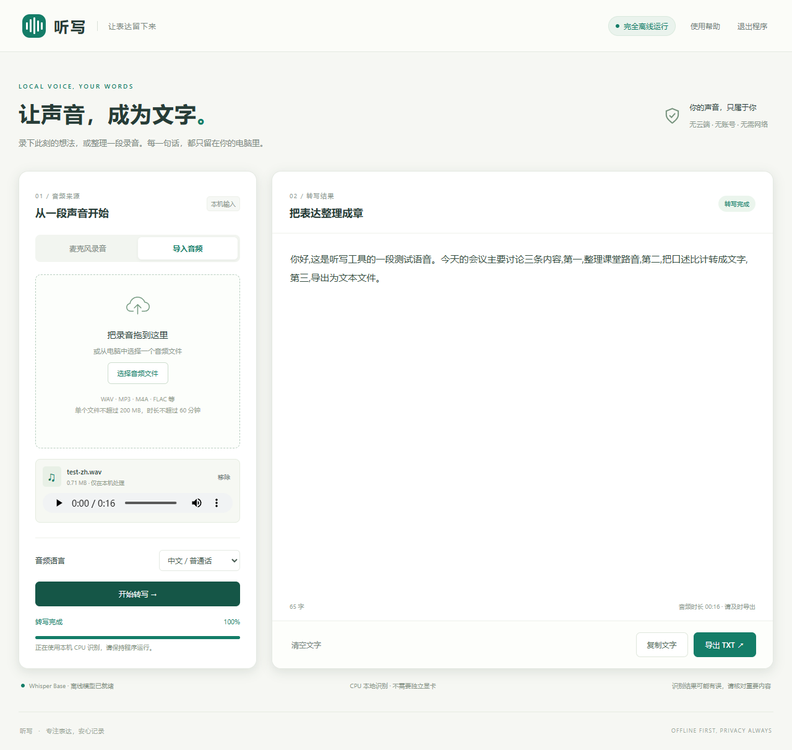

# Tingxie — offline speech-to-text for Windows

> Turn speech into text on your own machine. Models and runtime are bundled, so even the very first launch works without a network connection.



Tingxie (听写) is a small desktop tool for Windows 10/11 x64 that records from your microphone or imports an audio file, transcribes it with Whisper Base running on the CPU, and lets you edit, copy or export the result as TXT. No cloud, no account, no GPU, no build step in the UI.

## Features

- **Record or import** — in-browser recording with playback before transcription, plus drag & drop for WAV / MP3 / M4A / MP4 / FLAC / OGG / WEBM / AAC / WMA / OPUS.
- **Language control** — Chinese (Mandarin), English, or automatic detection.
- **Editable results** — edit inline, copy to clipboard, export UTF-8 TXT (with BOM, so Notepad and Excel open it correctly).
- **Visible progress** — decoding → voice activity detection → model loading → segment-by-segment progress with a real percentage.
- **Nothing left behind** — the temporary audio file is deleted as soon as the job ends; transcripts live in memory only.
- **Loopback only** — the server binds `127.0.0.1`, validates `Host` / `Origin` and requires a per-launch token, so neither the LAN nor a random website can drive it.

## Quick start (end users)

1. Download `Tingxie-Windows-x64-offline.zip` from [Releases](../../releases) (~224 MB).
2. **Extract the whole folder** — the EXE needs `_internal/` next to it (model + runtime live there).
3. Double-click `Tingxie.exe`; the browser opens the local UI automatically.
4. Record or import → pick a language → transcribe → edit / copy / export.

## Run from source

```powershell
git clone https://github.com/jyuaner/Tingxie.git
cd Tingxie

python -m venv .venv
.\.venv\Scripts\Activate.ps1
python -m pip install -r requirements.txt

python scripts/fetch_model.py    # one-time download of whisper-base (CTranslate2)
python app.py                    # picks a free port and opens the browser
python app.py --port 8722 --no-browser --debug
```

`models/whisper-base/` must contain `model.bin`, `config.json`, `tokenizer.json` and `vocabulary.txt` — see [models/README.md](models/README.md).

## Build the offline package

```powershell
python -m PyInstaller tingxie.spec --noconfirm
# or the wrapper that also zips the result:
pwsh -File scripts/build.ps1
```

Output: `dist/Tingxie-windows-x64/` (`Tingxie.exe` + `_internal/` including the model, `static/` and `templates/`). Compress that directory to get the redistributable offline bundle.

## Architecture

```
┌─────────────────────── Browser (localhost) ───────────────────────┐
│ index.html + app.js + core.mjs + style.css                       │
│ MediaRecorder · drag & drop · editor · progress polling          │
└──────────────▲────────────────────────────────────┬──────────────┘
               │ fetch + X-App-Token                │ multipart audio
┌──────────────┴────────────────────────────────────▼──────────────┐
│ Waitress on 127.0.0.1  ←  Flask (webapp.py)                      │
│ Host/Origin checks · CSP · 201 MiB cap · single-job JobManager    │
└──────────────▲────────────────────────────────────┬──────────────┘
               │ progress / stage / text callbacks   │ worker thread
┌──────────────┴────────────────────────────────────▼──────────────┐
│ transcriber.py                                                   │
│ PyAV decode → mono 16 kHz int16 (hard 3600 s ceiling)            │
│ Silero VAD → faster-whisper Whisper Base (CPU, int8, beam 3)     │
└──────────────────────────────────────────────────────────────────┘
```

- **Frontend**: plain HTML/CSS/ES modules — no bundler, no framework.
- **Backend**: Flask + Waitress, one job at a time, results kept in memory.
- **Inference**: `faster-whisper` on CTranslate2 with `device="cpu"`, `compute_type="int8"`, `cpu_threads=min(4, cpu_count)`; VAD filtering enabled; Chinese runs get a simplified-Chinese punctuation prompt.
- **Packaging**: PyInstaller onedir; the model and static assets are collected as data files.

### HTTP API

| Method | Path | Notes |
| --- | --- | --- |
| GET | `/` | Single-page UI, injects the per-launch token |
| GET | `/api/info` | Model name, offline flag, upload limits, readiness, latest job |
| POST | `/api/transcriptions` | `multipart/form-data`: `audio` + `language` (`zh`/`en`/`auto`) → `202 {id}` |
| GET | `/api/transcriptions/<id>` | Snapshot: `state`, `stage`, `progress`, `text`, `segments`, `duration`, `language`, `error` |
| POST | `/api/shutdown` | Graceful stop when idle |

Errors are always `{"error": "..."}` with `400 / 403 / 404 / 409 / 413 / 503`.

## Performance (CPU only)

| Machine | Sample | 10 minutes of audio |
| --- | --- | --- |
| i5-1135G7 (4 threads) | whisper-base int8 | ≈ 1.5–2.5 min |
| R5-5600U (4 threads) | whisper-base int8 | ≈ 1.5–2.5 min |
| i5-8250U | whisper-base int8 | ≈ 3–5 min |
| Low-power Celeron / Pentium | — | noticeably slower; split long files |

Numbers vary with speech density and background load; VAD skips silence, so quiet recordings finish faster.

## Limitations

- Windows 10/11 x64 only; older CPUs depend on the instruction set (AVX2 is the safe bet).
- One file at a time: **200 MB / 60 minutes** maximum, enforced in both the UI and the server.
- Batch transcription of a finished recording — not real-time streaming.
- No speaker diarization, no auto summary, no second-pass punctuation model.
- Noisy audio, strong accents and jargon still produce errors; proofread anything important.
- Transcripts are memory-only: export before closing the program.

## Privacy

- Recognition runs entirely on the local CPU; the app makes no outbound business requests.
- `HF_HUB_OFFLINE=1` and `local_files_only=True` — a missing model raises an error instead of downloading.
- Uploaded audio goes to the system temp directory and is `unlink`ed when the job ends (success or failure).
- The server binds loopback only and rejects requests without the per-launch token.

## FAQ

**The browser did not open.** Check the URL printed in the console (`http://127.0.0.1:<port>/`); the port is random on each launch to avoid conflicts.

**"Offline model incomplete".** The archive was not fully extracted. Verify `_internal/models/whisper-base/` contains all four files (`model.bin` ≈ 138 MB).

**"A task is already running".** The queue holds a single job — wait for it or restart the program.

**Empty transcript.** Voice activity detection runs first; silence or very low input volume is reported as no speech. Check the input device and recording level.

**Antivirus warning.** Unsigned PyInstaller executables often trip heuristics. Build from source yourself or allowlist the folder.

## License

[MIT](LICENSE). Whisper weights are MIT (OpenAI), `faster-whisper` and CTranslate2 ship under their own licenses (see `_internal/licenses/` in the packaged build).

---

中文文档见 [README.md](README.md)。